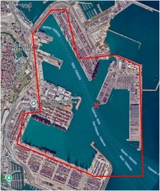
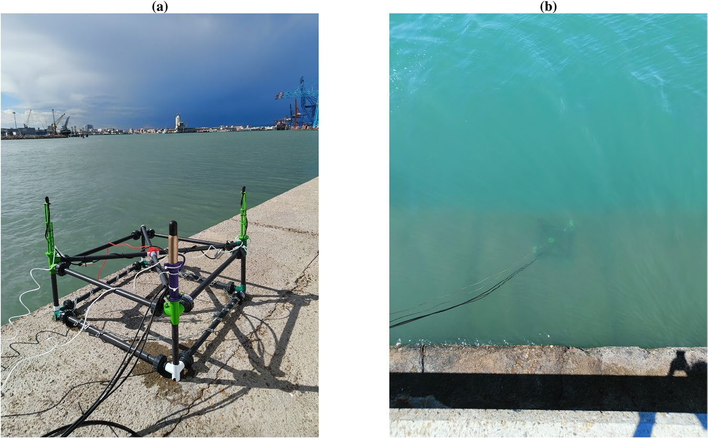
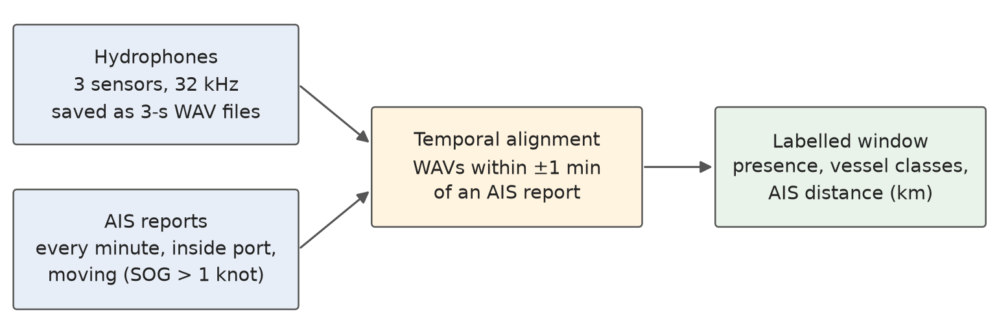
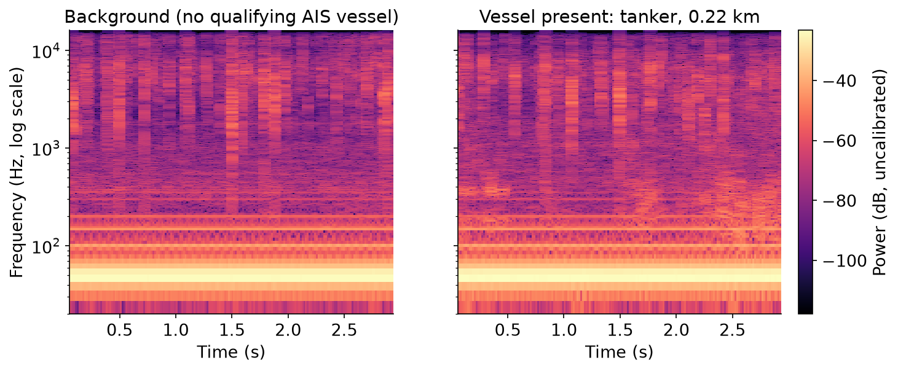
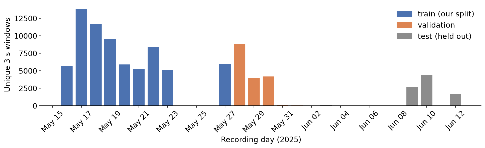
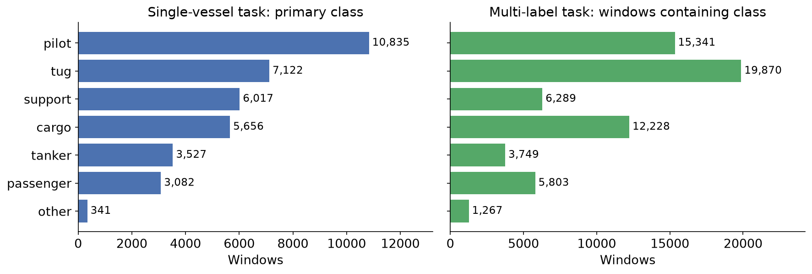
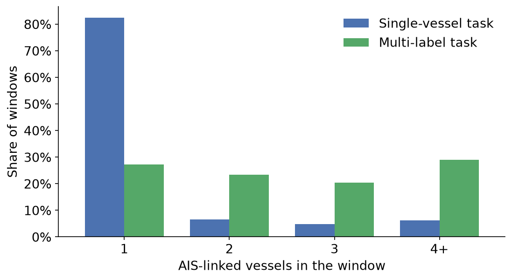
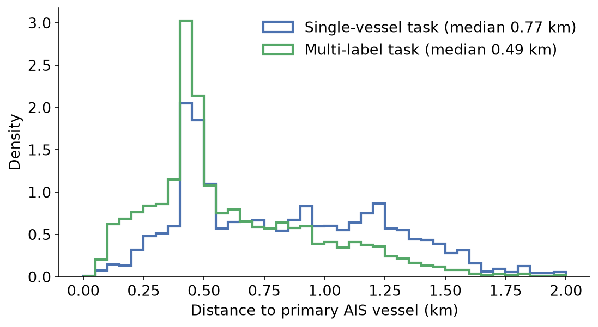
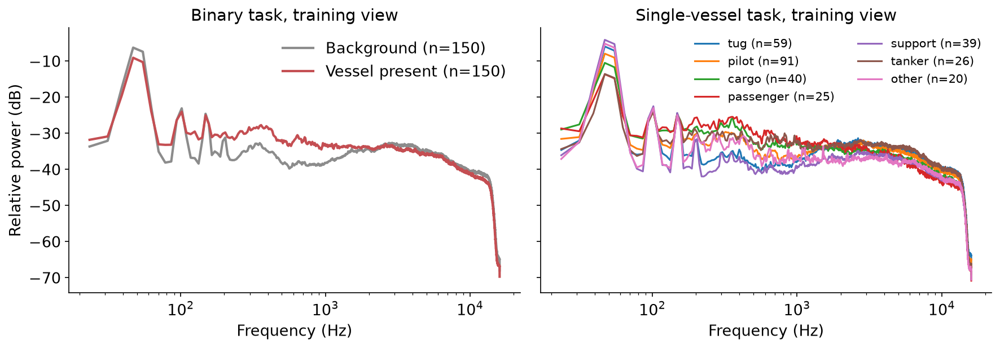

<!-- _class: lead -->
<!-- _paginate: false -->

# PORTIA: Listening for Vessels in a Busy Port

Dataset background, data preparation, and exploratory analysis

Machine Learning group project, Johns Hopkins University

---

<!-- _footer: "Background: Hildebrand (2009); Erbe et al. (2019)." -->

# Motivation

- Shipping is a major source of underwater noise near coasts and ports.
- Ports also need to know which vessels are moving and where.
- AIS tracks transponder-equipped ships, but it says nothing about the noise they make.
- A hydrophone hears every nearby source, but raw audio has no labels.
- **Our question:** How well can a 3-second underwater recording tell us about the vessel traffic around it?

---

<!-- _footer: "Background: Hildebrand (2009); McKenna et al. (2012); Merchant et al. (2015)." -->

# Background: passive acoustic monitoring and AIS

- **Passive acoustic monitoring (PAM)** records sound with hydrophones. It never transmits, and nothing is installed on the vessels.
- Ships radiate sound from **propeller cavitation** (broadband) and from **engines and shafts** (tonal lines at low frequencies).
- Radiated noise differs with ship type, size, and speed. What the sensor receives also depends on distance and the path the sound takes.
- **AIS** (Automatic Identification System) broadcasts a vessel's ID, position, speed, and type. Small craft often don't carry it.

---

<!-- _footer: "Figures: Fernández García et al. (2026), Figs. 1–2, CC BY-NC-ND 4.0. Facts on this slide are the authors' description." -->

# Where PORTIA comes from

- A 26-day campaign in the **Port of Valencia, Spain**, in May–June 2025.
- One fixed node at the quay edge, near a 300 m passage and about 1.25 km from the port entrance.
- Three hydrophones in a triangular frame, recorded by a Raspberry Pi through a 4-input audio interface.
- Built by UPM and Fundación Valenciaport within the EU SMAUG project.

---

<!-- _footer: "Source: Fernández García et al. (2026), Methods. The ~5% check and the distance caveat are the authors' statements." -->

# How windows were collected and labelled

- Recording is **AIS-gated**. It starts when a qualifying vessel is in the port polygon. It stops after 5 minutes with none, and those quiet intervals become "structured background."
- Labels are automatic. The authors inspected about 5% of windows as a sanity check; there is no full manual annotation.
- Distance is AIS geometry from sensor to vessel, not an acoustic range.

---

<!-- _footer: "Paper counts: Fernández García et al. (2026). Zenodo v1 counts: our download of record 19204539." -->

# Collection, release, and benchmarks are different things

| Level | What it is | Size | Public |
|---|---|---|---|
| Raw archive + paired dataset | All 3-s WAVs aligned with AIS | 260,932 windows, >300 GB | No |
| Binary Detection benchmark | Vessel vs. background, balanced | 36,148 | Yes |
| Single-Vessel benchmark | Windows with one AIS vessel | 39,125 | Yes |
| Multi-Label benchmark | Scenes with overlapping vessels | 34,996 | Yes |

- The three benchmarks share windows: 110,269 rows, but **95,022 unique windows**.
- Each comes with MMSI-aware train/val/test splits (70/15/15), meant to keep a vessel in one split.
- The Zenodo v1 files we downloaded differ a little (e.g., single-vessel 39,996). We report our own counts from those files.

---

<!-- _footer: "Our EDA on training-day audio. The tanker is the AIS-linked vessel, 0.22 km away; other sources may also be present." -->

# What one window looks like

- 3 s at 32 kHz, 4 channels. Channels 0, 2, 3 are hydrophones; channel 1 is unused (median RMS 0.0001 vs. 0.08–0.14).
- Both windows show steady lines near 50, 100, 150, 200 Hz and short broadband clicks. The authors attribute such clicks to snapping shrimp.
- The two windows look alike by eye. The AIS label is not obvious from the picture.

---

<!-- _footer: "Our checks: data-prep/prepare.py and eda/eda.ipynb, on Zenodo v1 manifests. Train/val days only for the label counts." -->

# Data preparation, step 1: checking the release

Before sampling anything, we checked the metadata against the paper.

- **147 WAVs** appear in more than one official split of the same task.
- **283 WAVs** have conflicting labels across rows, and 1,579 binary rows have no target.
- **17.5%** of single-vessel rows list more than one AIS vessel. The paper says exactly one.
- One selected WAV was only 1 s long. We replaced it with another eligible file, chosen deterministically.

We exclude and flag these cases. We don't relabel anything.

---

<!-- _footer: "Our protocol: data-prep/prepare.py (seed 42). The authors recommend keeping their MMSI splits; we departed from that because of the overlaps above." -->

# Data preparation, step 2: splitting by recording day

- One split for all three tasks, so no WAV or day crosses train, validation, and test.
- A vessel can still show up on more than one day. We have not counted how many MMSIs cross the split.
- We took 300 training windows and 200 validation windows per task. Coverage can add validation windows on top of the 200. The sample is 1,506 development WAVs.
- Test-day audio is never opened. May 31 to June 2 have almost no released windows.

---

<!-- _footer: "Our EDA: train + validation days, after exclusions, Zenodo v1. AIS type-code mapping: Fernández García et al. (2026), Table 1." -->

# EDA: the classes are imbalanced

- Pilot boats and tugs dominate. "Other" has only 341 single-vessel windows.
- Multi-label counts are larger because one window can hold several classes.
- The authors kept this imbalance on purpose and recommend macro-F1 over accuracy.

---

<!-- _footer: "Our EDA (train + validation days). The 0.40–0.48 km peak and the manoeuvring-zone explanation are from Fernández García et al. (2026)." -->

# EDA: many windows link several vessels at varying distances

 

- 73% of multi-label windows link 2 or more AIS vessels; 29% link 4 or more.
- Distances run from 0.02 to 1.98 km. The multi-label median is 0.49 km and the single-vessel median is 0.77 km.
- The peak near 0.45 km lines up with manoeuvring areas, according to the authors.

---

<!-- _footer: "Our EDA: median Welch spectra (channels 0, 2, 3) of training-view WAVs, normalized per file. Descriptive only; small n per class and distance is not controlled." -->

# EDA: vessel windows shift energy toward 200–2,000 Hz

- Relative to total power, vessel windows sit about **+3.6 dB** above background at 200–2,000 Hz, and slightly below it elsewhere.
- Per class, the gap ranges from −2.1 dB (support) to +5.2 dB (passenger).
- The strong peaks near 50 Hz appear with or without vessels. Their source is unknown.

---

<!-- _footer: "These are the authors' benchmarks. We have not tested any of them." -->

# Hypotheses: what might the audio predict?

| | Predict | Why audio might carry it | What makes it hard |
|---|---|---|---|
| **H1** Presence *(benchmark)* | Vessel vs. background | Propeller and engine noise; our 200-2,000 Hz gap | Background comes from AIS-quiet periods, so time-of-day cues may leak in; boats without AIS count as background |
| **H2** Vessel type *(benchmark)* | Class of the one AIS vessel | Size, engines, and speed differ by class | 7 imbalanced classes; 17.5% of "single" windows have more vessels; distance confounds type |
| **H3** Class mix *(benchmark)* | Multi-hot vector of 7 classes | Each vessel adds its own components | 73% of windows overlap; labels describe the scene, not separated sources |

---

<!-- _footer: "Authors' limitations: Fernández García et al. (2026), Usage Notes. Peak level and split overlaps: our checks." -->

# Limitations

- Labels come from AIS, not from listening. Small craft, moored or idling ships, and shrimp all count as background.
- A ±1 minute match for a 3-second clip means a linked vessel may be inaudible or masked.
- One port, one sensor position, a few weeks in spring. The authors don't claim transfer to other sites.
- Every WAV we checked peaks near 1.0, so absolute loudness is probably not comparable across files.
- The public files don't fully match the paper, and our working subset is small.
- Proximity is not a released benchmark. The files look peak-scaled, so loudness is a weak distance cue.

---

<!-- _footer: "ShipsEar: Santos-Domínguez et al. (2016). DeepShip: Irfan et al. (2021)." -->

# Conclusions

- PORTIA pairs a real port soundscape with automatic AIS labels.
- Keep the counts apart: 260,932 internal windows, 95,022 unique public windows, and our 1,506 development WAVs.
- ShipsEar and DeepShip are mostly isolated passages. PORTIA is a working port, so vessels overlap.
- The EDA shows class imbalance, frequent overlap, and a modest 200-2,000 Hz gap between vessel and background medians.
- Label and split problems led us to a day split. That split does not keep one vessel in one set.
- **Our question:** How well can a 3-second underwater recording tell us about the vessel traffic around it?

---

<!-- _class: refs -->
<!-- _paginate: false -->

# References

- Erbe, C., et al. (2019). The effects of ship noise on marine mammals. *Frontiers in Marine Science*, 6, 606.
- Fernández García, A., et al. (2026). PORTIA: A large-scale port acoustic dataset with AIS-grounded annotations for AI-based vessel monitoring. *Scientific Data*. https://doi.org/10.1038/s41597-026-08384-9
- Fernández García, A., Belmonte Hernández, A., Higon, J. M., Company, R., Pérez Carrasco, F. J., Álvarez García, F., & Gutiérrez, Á. (2026). *PORTIA Dataset* (v1) [Data set]. Zenodo. https://doi.org/10.5281/zenodo.19204539
- Hildebrand, J. A. (2009). Anthropogenic and natural sources of ambient noise in the ocean. *Marine Ecology Progress Series*, 395, 5–20.
- Irfan, M., et al. (2021). DeepShip: An underwater acoustic benchmark dataset and a separable convolution based autoencoder for classification. *Expert Systems with Applications*, 183, 115270.
- McKenna, M. F., Ross, D., Wiggins, S. M., & Hildebrand, J. A. (2012). Underwater radiated noise from modern commercial ships. *JASA*, 131(1), 92–103. https://doi.org/10.1121/1.3664100
- Merchant, N. D., et al. (2015). Measuring acoustic habitats. *Methods in Ecology and Evolution*, 6, 257–265.
- Santos-Domínguez, D., et al. (2016). ShipsEar: An underwater vessel noise database. *Applied Acoustics*, 113, 64–69.
- Project code and figures: https://github.com/jose-perales/jhu-machine-learning-group-research-project
